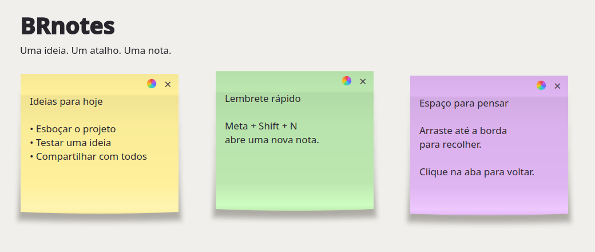
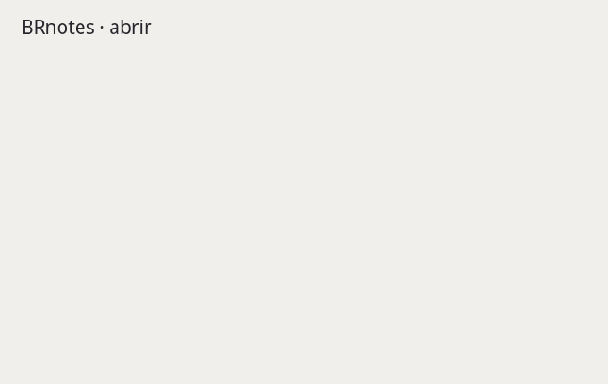
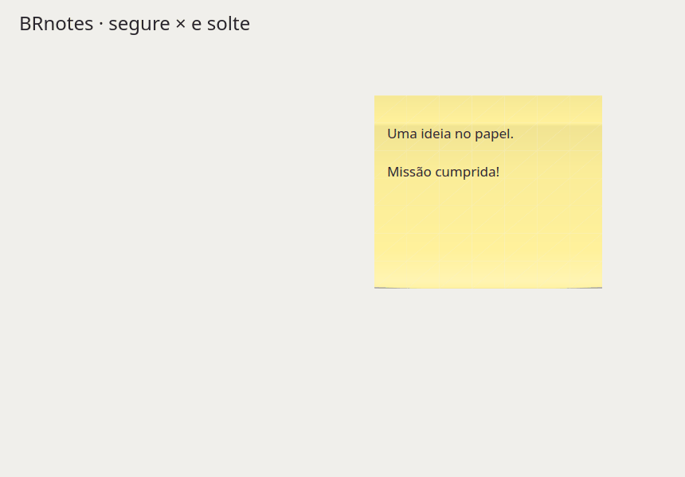
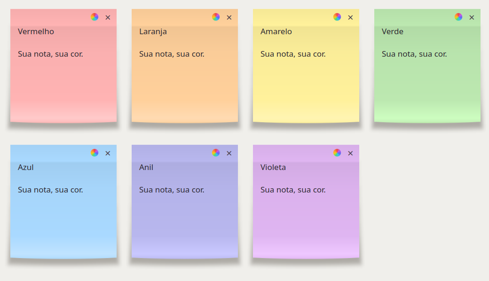
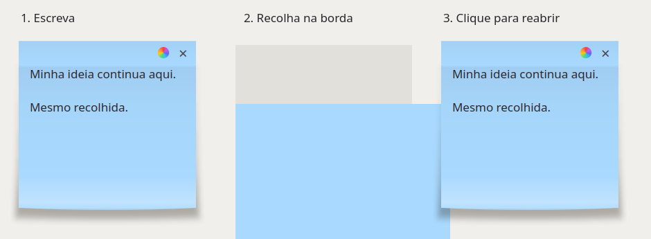

# BRnotes

**One idea. One shortcut. One note.**

Temporary sticky notes for Linux, with a paper-like appearance, seven colors,
and tabs that tuck into the edges of your screen. Built and tested on **Fedora KDE Plasma**.

[](https://github.com/dalvan03/BRnotes/actions/workflows/tests.yml)
[](LICENSE)



> **Disposable by design.** BRnotes does not save your notes. Closing a note,
> terminating its process, or logging out discards its text.
> Use it for temporary reminders, not information you need to keep.

## Features

- **A new note with every shortcut:** `Meta + Shift + N` opens another independent window.
- **No window frame or title bar:** just the paper, a color picker, and the × button.
- **Paper-like appearance:** a glued top edge, a gentle gradient, a slightly curved bottom, and a soft shadow.
- **Special disposal animation:** hold × for more than one second and release to crumple the paper and toss it into a bin.
- **Smooth transitions:** opening, closing, folding, and restoring in 160–240 ms.
- **Seven colors:** soft shades of red, orange, yellow, green, blue, indigo, and violet.
- **Move and resize:** drag the empty area above the text or the note's edges.
- **Fold into any screen edge:** drag a note to an edge to leave only a small tab visible.
- **One-click restore:** click the tab to bring back the note with its text and color intact.
- **Text editing:** type, select, copy, paste, undo, and redo.
- **Always within reach:** notes stay above normal windows.
- **Local, no account required:** the application makes no network requests and does not write note text to files.

## Motion that feels like paper

Notes gently expand when opened, shrink into a tab when folded, expand again
when restored, and fade out with a slight contraction when closed.



## Crumple it and toss it away

A **quick click on ×** keeps the regular closing animation. **Hold the left mouse
button on × for more than one second, then release over the button** for the special animation:

1. A small bin rises from the bottom-left corner of the note's monitor.
2. The note crumples into a paper ball, retaining its color and text texture.
3. The ball spins and follows a constant-gravity arc toward the opening.
4. The paper drops inside; the bin reacts to the impact and slides off-screen.

A ring around × indicates how long you have held the button. Releasing outside
it cancels the action. The effect does not intercept desktop clicks or create
files in your system trash. With `BRNOTES_REDUCED_MOTION=1`, the note closes
directly instead.



## Seven colors, one circle

Click the **multicolored circle next to ×**. Each note has its own color,
which also appears on its folded tab. New notes start yellow.



## Clear some space without losing your idea

Drag a note to the left, right, top, or bottom of your monitor's available work
area. It becomes a small tab in the same color. Click to reopen it.
Space reserved for KDE panels is respected.



*Images are composed from the application's actual widgets using fictional text.
Example images currently contain Portuguese text. Regenerate the static examples
with `python3 docs/render_examples.py`.*

## Install on Fedora KDE

Requirements: **Python 3.10+**, **PySide6/Qt 6**, **Pillow**, **X11 or XWayland**,
and **KDE Plasma 6** for automatic shortcut configuration.

```bash
sudo dnf install git python3-pyside6 python3-pillow xorg-x11-server-Xwayland glib2

git clone https://github.com/dalvan03/BRnotes.git
cd BRnotes
/usr/bin/python3 manage.py install
```

Run the installer **without sudo**. It installs for your user only and adds
BRnotes to the application menu. The default shortcut is configured if it is
available; shortcuts already used by another application are not overwritten.
Existing customized BRnotes shortcuts are preserved.

Now press **Meta + Shift + N**. Meta is usually the Windows/Super key.

### Customize the shortcut

Open **System Settings → Keyboard → Shortcuts**, find **BRnotes**, and choose
your preferred key combination. If it is not listed, add BRnotes using the
application picker on that screen.

To install without automatically configuring a shortcut:

```bash
/usr/bin/python3 manage.py install --no-shortcut
```

### Other distributions

Fedora KDE is the primary target. Other distributions with Plasma 6 and XWayland
may work but have not yet been manually validated. Install the equivalents of
the dependencies above, or use a virtual environment:

```bash
python3 -m venv .venv
.venv/bin/python -m pip install -r requirements.txt
.venv/bin/python manage.py install
```

Keep the `.venv` directory in that case: the launcher uses the interpreter that
ran the installer. Native GNOME/Wayland, Windows, and macOS are not supported
targets. BRnotes uses Qt's XCB backend even in Wayland sessions to control window
and tab positioning; Wayland sessions without XWayland are not compatible.

## Usage

| Action | How |
| --- | --- |
| New note | Press `Meta + Shift + N` or launch BRnotes from the application menu |
| Write | Click inside the text area |
| Change color | Click the multicolored circle |
| Move | Drag the empty area above the text or the margins |
| Resize | Drag a corner or an outer edge |
| Fold | Release near an edge of the monitor's available work area |
| Restore | Click the small colored tab |
| Discard with the special animation | Hold **×** for more than 1 second and release over it |
| Discard | Click **×**; there is no confirmation or saving |

Dragging inside the editor selects text. The application does not provide
synchronization, history, recovery, or autosave.

### Reduce motion

To run without animations:

```bash
BRNOTES_REDUCED_MOTION=1 /usr/bin/python3 notas.py
```

## Update and uninstall

To update an installation from a clean checkout of the repository:

```bash
git pull --ff-only
/usr/bin/python3 manage.py install
```

Updates apply to new notes. Notes that are already open keep running the previous
version, preserving their content in memory.

To uninstall from the repository directory:

```bash
/usr/bin/python3 manage.py uninstall
```

Without the repository, for a default installation:

```bash
/usr/bin/python3 ~/.local/share/brnotes/manage.py uninstall
```

The uninstaller removes the launcher, shortcut, and application files. It does
not close open notes or remove system dependencies. Installation paths follow
`XDG_DATA_HOME` when set, otherwise they use `~/.local/share`.

## Development and testing

```bash
/usr/bin/python3 notas.py
/usr/bin/python3 -m unittest discover -s . -v
```

UI tests require a graphical session and open temporary windows.
For a headless environment, use Xvfb:

```bash
xvfb-run -a -s '-screen 0 1920x1080x24' python3 -m unittest discover -s . -v
```

The suite covers editing, pasting, moving, resizing, folding at all four edges,
restoring, independent colors, short and long clicks, canceled disposal,
ballistic trajectories, animation cleanup, and the installer. CI runs on a
virtual X server; it does not replace testing the physical keyboard shortcut
in Plasma.

## Known limitations

- Tabs can overlap when dropped at the same location.
- Disconnecting monitors during use is not specifically handled.
- Mixed monitor scaling and other compositors need further validation.
- Each note runs in its own Python process; opening many notes increases memory usage.
- Text lives in process memory. This is not a guarantee of isolation from the
  clipboard, swap, or system tools.

## Community

Found a bug or have an idea? [Open an issue](https://github.com/dalvan03/BRnotes/issues).
Pull requests are welcome; see the [contribution guide](CONTRIBUTING.md) (currently in Portuguese).

**[MIT license](LICENSE)** — use, modify, and share while retaining the license notice.
